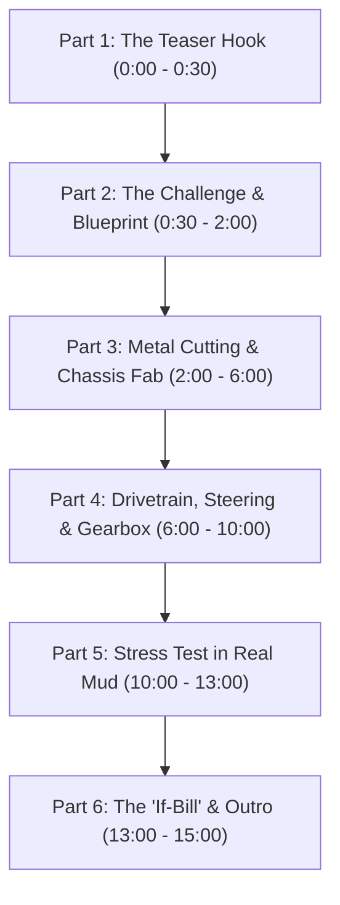

# 🎬 GG Creation (@GGCreative-x9o) — Master Script Package

> **Channel Identity:** **GG Creation** (`#tamiltoymaker`)  
> **Creators & Team:** Gopi (Founder & Lead Creator), Gokul / GG (Technical Lead), Manoj (Creative Assistant)  
> **Core Focus:** Grassroots mechanical engineering, scratch-built miniature tractors (Mahindra, John Deere, Kubota), real working hydraulics/pneumatics, custom gearboxes, and 100% transparent project bills ("If-Bill").

---

## 📑 SCRIPT 1: The Official Channel Trailer & "About Us" Master Script
*Use this for your YouTube Channel Trailer (pinned on the home page) and website intro video.*

* **Target Duration:** 90 – 120 Seconds  
* **Pacing:** Fast, energetic, inspiring  
* **Music:** Heavy rhythmic village percussion / driving bass beats that slow down into an inspiring acoustic rhythm.

---

### [0:00 – 0:15] The Hook — The Magic of Grassroots Engineering
**Visuals (B-Roll):**  
* Rapid cuts: Sparks flying from a 100mm angle grinder cutting metal sheet.  
* Close-up of miniature dual-tread tractor wheels churning through thick, real farm mud.  
* Syringe hydraulic cylinders lifting a working trolley dumped with real soil.

**Voiceover / Host (Gopi / Gokul on camera in workshop):**
> **(Tamil / Tanglish):**  
> *"பெரிய பெரிய ஃபேக்டரி இல்லாம, விலை உயர்ந்த மெஷின்கள் இல்லாம... ஒரு சாதாரண கிராமத்து பட்டறையில இருந்து ரியல் இன்ஜினியரிங் பண்ண முடியுமா? கண்டிப்பா முடியும்! Welcome to **GG Creation**!"*  
>  
> **(English Translation):**  
> *"Can real mechanical engineering happen without multi-crore factories or expensive CNC machines, straight out of a humble village workshop? Absolutely YES. Welcome to **GG Creation**!"*

---

### [0:16 – 0:45] Who We Are & The Mission
**Visuals (B-Roll):**  
* Gopi welding a miniature 20x20mm steel box chassis.  
* Gokul measuring brass reduction gears with a digital vernier caliper and testing 12V 775 high-torque DC motors.  
* Manoj assembling the steering tie rods and preparing automotive enamel spray paint.  
* Lower-third graphics: **Gopi (Founder & Maker)** • **Gokul (Technical Lead)** • **Manoj (Creative Assistant)**.

**Voiceover / Host:**
> **(Tamil / Tanglish):**  
> *"நாங்க வெறும் பிளாஸ்டிக் பொம்மைகள் செய்யறது இல்ல. ரியல் டிராக்டர் மெக்கானிசம் — 12V High-Torque Motors, Brass Gearbox, Functional Steering, அப்புறம் ரியல் ஆயில்-ஃபுளூயிட் ஹைட்ராலிக்ஸ் வரைக்கும் எல்லாமே ஸ்கிராட்ச்-ல இருந்து நாங்களே உருவாக்கறோம்.  
> நம்ம அடையாளம்: **#tamiltoymaker**!"*  
>  
> **(English Translation):**  
> *"We don't build hollow plastic toys. We build functioning miniature machines from scratch — complete with 12V high-torque electric powertrains, custom brass gearboxes, realistic steering columns, and genuine fluid-powered hydraulics. This is the heart of **#tamiltoymaker**!"*

---

### [0:46 – 1:15] Our Signature Builds & Complete Transparency
**Visuals (B-Roll):**  
* Showcase of hero builds:
  * **Mahindra 415DI XP PLUS** in glossy red.
  * **John Deere 5050D** in iconic green & yellow with custom front weights.
  * 4x4 custom farm trailers and custom-fabricated cage wheels.
* Quick graphic overlay of the **Itemized "If-Bill"**: Motor ₹1,100 | Sheet Metal ₹950 | Wheels ₹650 | Total Transparency.

**Voiceover / Host:**
> **(Tamil / Tanglish):**  
> *"மகிந்திரா 415DI, ஜான் டீர் 5050D-ன்னு ஒவ்வொரு மாடலையும் பார்ட்-பார்ட்டா செஞ்சு காட்டி, அதுக்கு செலவான ஒவ்வொரு ரூபாயையும் 'If-Bill' மூலமா ஓப்பனா உங்க முன்னாடி வைக்கிறோம். நீங்களும் உங்க வீட்லயே புதுசா உருவாக்க ஒரு உத்வேகம் கொடுக்கிறதுதான் எங்க லட்சியம்!"*  
>  
> **(English Translation):**  
> *"From scale Mahindra 415DI to John Deere 5050D replicas, we document the entire build step-by-step. Even better: we publish our exact component costs and material bills so anyone in the community can learn, replicate, and invent."*

---

### [1:16 – End] Call To Action (Outro)
**Visuals (B-Roll):**  
* Trio standing together with their flagship tractor moving smoothly across the workbench.  
* Screen graphics: Subscribe button, Bell icon, YouTube handle `@GGCreative-x9o`, and website link.

**Voiceover / Host:**
> **(Tamil / Tanglish):**  
> *"கற்றுக் கொள்வோம், உருவாக்குவோம், சாதிப்போம்! எங்க அடுத்த மெகா புராஜெக்ட் மிஸ் பண்ணாம பார்க்க இப்போதே **Subscribe to GG Creation (@GGCreative-x9o)** பண்ணுங்க! பெல் ஐகானை தட்டுங்க, கமெண்ட்ல உங்க சப்போர்ட்ட சொல்லுங்க!"*  
>  
> **(English Translation):**  
> *"Let's learn, build, and innovate together. To never miss our next mega build series, hit that **Subscribe button on GG Creation (@GGCreative-x9o)**, ring the notification bell, and leave your thoughts in the comments!"*

---

## 🚜 SCRIPT 2: The Universal "Build Series" Episode Master Script
*Use this modular 6-part framework for any long-form build video (e.g., "Building John Deere 5050D from Scratch").*



| Phase | Duration | Visual Cue | Narration / Dialogue Key Points |
| :--- | :--- | :--- | :--- |
| **1. Hook & Teaser** | 0:00 – 0:30 | 5-second slow-motion shot of the finished mini-tractor pulling a loaded trolley out of mud. | *"Will this miniature tractor pull 5KG of pure farm soil, or will the gears snap? Let's build it and find out!"* |
| **2. Blueprint & Concept** | 0:30 – 1:30 | Host at workbench holding hand-sketched design and raw steel profiles. | Introduce the model, dimensions, scale factor, and target specs (motor RPM, gear reduction, steering angle). |
| **3. Chassis & Metalwork** | 1:30 – 5:00 | ASMR workshop audio: angle grinder cutting, drilling, filing, welding tack points. | Explain the steel grade and thickness (1.5mm cold-rolled sheet), safety tips, and alignment tricks for straight axles. |
| **4. Powertrain & Gearbox** | 5:00 – 9:00 | Macro shots of brass pinions, 775 motor mount, soldering ESC, and grease application. | Highlight why plastic gears fail and why custom brass pinions with high-viscosity SV grease are necessary. |
| **5. Painting & Final Assembly** | 9:00 – 11:30 | Primer coat, color-matching signature paint (Mahindra Red / JD Green), headlight LED wiring. | Explain the finishing steps to make miniature sheet metal look like real die-cast factory metal. |
| **6. Mud Test & 'If-Bill'** | 11:30 – 15:00 | Real outdoor muddy field trial, followed by the onscreen table of the full component bill. | Show torque performance, present total costs honestly, and ask viewers what vehicle to build next in the comments. |

---

## ⚡ SCRIPT 3: Viral 60-Second YouTube Short / Reel Script
*Designed for maximum retention, fast visual loop, and algorithm promotion.*

* **Audio:** High-tempo phonk or energetic cinematic beat.
* **Aspect Ratio:** 9:16 Vertical

* **[00:00 - 00:05] Hook:**  
  *Action:* Drop the miniature tractor into a muddy puddle and gun the throttle — water and mud spray in slow-mo.  
  *Text on Screen:* **Toy or Real Tractor? 🚜🔥 #tamiltoymaker**  
  *Voiceover:* *"Don't call this a toy — watch what happens when we give it full throttle!"*

* **[00:05 - 00:20] The Build Flash:**  
  *Action:* 4 rapid jump-cuts:
  1. Angle grinder cutting sheet metal.
  2. Soldering the 12V motor switch.
  3. Syringe hydraulic mechanism pumping fluid.
  4. Spray painting the body.  
  *Voiceover:* *"Hand-cut steel, 12V high-torque motor, real working steering, and handmade brass gears!"*

* **[00:20 - 00:45] The Mud Pull Test:**  
  *Action:* Mini tractor hitched to a trolley filled with bricks or wet clay. Rear wheels dig into the soil, grip, and pull it clean out.  
  *Voiceover:* *"Zero plastic gears. Pure village engineering from Tamil Nadu!"*

* **[00:45 - 00:60] Loop & CTA:**  
  *Action:* Close up of creator holding the machine, smiling, pointing to subscribe button.  
  *Voiceover:* *"Full build video and exact material cost on our channel! Subscribe to **GG Creation** now!"*

---

## 🏷️ Essential Channel SEO Tags & Descriptions to Pair With Scripts

* **Channel Handle:** `@GGCreative-x9o`
* **Primary Hashtags:** `#tamiltoymaker` `#ggcreation` `#diytractor` `#homemadeinventions` `#ruralengineering`
* **Video Description Boilerplate:**
  ```text
  Welcome to GG Creation! In this video, we build a working miniature [Model Name] from scratch using simple workshop tools.
  
  ⏱️ Time Invested: [X] Hours
  💰 Total Material Cost: ₹ [XXXX] (See full If-Bill on our website)
  
  🛠️ Tools & Components Used:
  - 12V 775 High-Torque DC Geared Motor
  - 1.5mm Cold-Rolled Sheet Metal
  - Custom Brass Reduction Gears
  
  🔔 Subscribe for more grassroots engineering: https://youtube.com/@ggcreative-x9o?si=3LtZbnrBawQbGshe
  📸 Instagram: @gj_farming23
  💬 WhatsApp: +91 90430 81667
  ```
